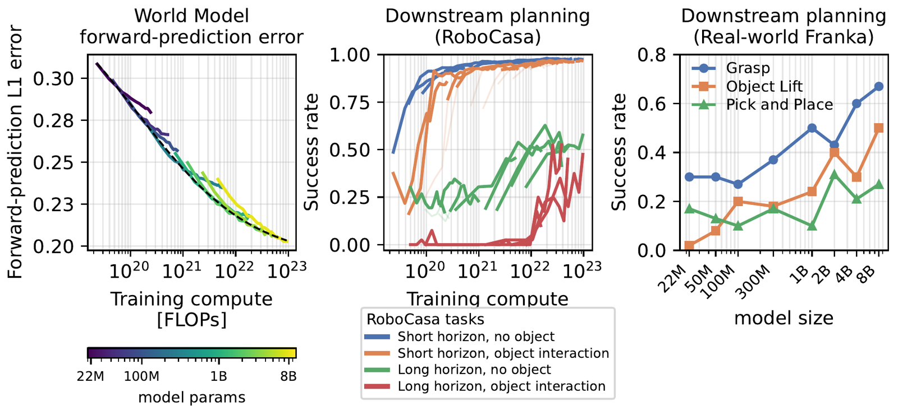

<h1 align="center">
    <p>🤖 <b>RoboJEPA</b></p>
</h1>

<h2 align="center">
    <p><i>Scaling Robotic Latent World Models</i></p>
</h2>

<div align="center" style="line-height: 1;">
  <a href="https://arxiv.org/abs/2610.10515" target="_blank" style="margin: 2px;"></a>
  <a href="https://github.com/facebookresearch/robo_jepa" target="_blank" style="margin: 2px;"></a>
  <a href="https://dl.fbaipublicfiles.com/robojepa/wm/wm-50m/cooldown_50m_120k.pth.tar" target="_blank" style="margin: 2px;"></a>
  <a href="LICENSE" style="margin: 2px;"></a>
</div>

<br>

<p align="center">
  <b><a href="https://ai.meta.com/research/">Meta FAIR</a></b> · <b><a href="https://robojepa.github.io/">Website</a></b>
</p>

<p align="center">
  Artem Zholus, Nicolas Beltran-Velez, Jianhao Yuan, Sarath Chandar, Tushar Nagarajan, Daniel Severo,
  Koustuv Sinha, Michal Drozdzal, Adriana Romero Soriano, Jeannette Bohg, Nicolas Ballas, Mahmoud Assran
</p>

<p align="center">
  PyTorch code and pretrained models for <b>RoboJEPA</b>: action-conditioned world models trained in the latent
  space of a frozen V-JEPA encoder, on robot data from 12 embodiments, at sizes from 22M to 8B parameters.
</p>

<p align="center">
  
</p>

RoboJEPA's imagination error, the error of its latent rollouts, follows a power law in training compute, and
downstream planning success improves predictably with it. A trained model plans zero-shot toward a single goal image,
in the RoboCasa simulator and on a real Franka, with a CEM / MPC planner in latent space. An optional diffusion decoder
turns latent rollouts back into video.

---

## 🎯 Pretrained Models

All world models share the frozen V-JEPA 2.1 ViT-G/384 encoder (1664-dim features) and differ in predictor size.

| Model | Width | Depth | Heads (KV) | Checkpoints (training step) | Config |
|---|---|---|---|---|---|
| RoboJEPA 22M | 512 | 7 | 4 (4) | [10k](https://dl.fbaipublicfiles.com/robojepa/wm/wm-22m/cooldown_22m_10k.pth.tar) · [20k](https://dl.fbaipublicfiles.com/robojepa/wm/wm-22m/cooldown_22m_20k.pth.tar) · [30k](https://dl.fbaipublicfiles.com/robojepa/wm/wm-22m/cooldown_22m_30k.pth.tar) · [40k](https://dl.fbaipublicfiles.com/robojepa/wm/wm-22m/cooldown_22m_40k.pth.tar) · [50k](https://dl.fbaipublicfiles.com/robojepa/wm/wm-22m/cooldown_22m_50k.pth.tar) · [60k](https://dl.fbaipublicfiles.com/robojepa/wm/wm-22m/cooldown_22m_60k.pth.tar) · [70k](https://dl.fbaipublicfiles.com/robojepa/wm/wm-22m/cooldown_22m_70k.pth.tar) · [80k](https://dl.fbaipublicfiles.com/robojepa/wm/wm-22m/cooldown_22m_80k.pth.tar) · [90k](https://dl.fbaipublicfiles.com/robojepa/wm/wm-22m/cooldown_22m_90k.pth.tar) · [100k](https://dl.fbaipublicfiles.com/robojepa/wm/wm-22m/cooldown_22m_100k.pth.tar) · [120k](https://dl.fbaipublicfiles.com/robojepa/wm/wm-22m/cooldown_22m_120k.pth.tar) · **[150k](https://dl.fbaipublicfiles.com/robojepa/wm/wm-22m/cooldown_22m_150k.pth.tar)** | [config.json](configs/released/wm-22m/config.json) |
| RoboJEPA 50M | 640 | 10 | 5 (5) | [10k](https://dl.fbaipublicfiles.com/robojepa/wm/wm-50m/cooldown_50m_10k.pth.tar) · [20k](https://dl.fbaipublicfiles.com/robojepa/wm/wm-50m/cooldown_50m_20k.pth.tar) · [30k](https://dl.fbaipublicfiles.com/robojepa/wm/wm-50m/cooldown_50m_30k.pth.tar) · [40k](https://dl.fbaipublicfiles.com/robojepa/wm/wm-50m/cooldown_50m_40k.pth.tar) · [50k](https://dl.fbaipublicfiles.com/robojepa/wm/wm-50m/cooldown_50m_50k.pth.tar) · [60k](https://dl.fbaipublicfiles.com/robojepa/wm/wm-50m/cooldown_50m_60k.pth.tar) · [70k](https://dl.fbaipublicfiles.com/robojepa/wm/wm-50m/cooldown_50m_70k.pth.tar) · [80k](https://dl.fbaipublicfiles.com/robojepa/wm/wm-50m/cooldown_50m_80k.pth.tar) · [90k](https://dl.fbaipublicfiles.com/robojepa/wm/wm-50m/cooldown_50m_90k.pth.tar) · **[120k](https://dl.fbaipublicfiles.com/robojepa/wm/wm-50m/cooldown_50m_120k.pth.tar)** | [config.json](configs/released/wm-50m/config.json) |
| RoboJEPA 100M | 768 | 14 | 6 (6) | [10k](https://dl.fbaipublicfiles.com/robojepa/wm/wm-100m/cooldown_100m_10k.pth.tar) · [20k](https://dl.fbaipublicfiles.com/robojepa/wm/wm-100m/cooldown_100m_20k.pth.tar) · [30k](https://dl.fbaipublicfiles.com/robojepa/wm/wm-100m/cooldown_100m_30k.pth.tar) · [40k](https://dl.fbaipublicfiles.com/robojepa/wm/wm-100m/cooldown_100m_40k.pth.tar) · [50k](https://dl.fbaipublicfiles.com/robojepa/wm/wm-100m/cooldown_100m_50k.pth.tar) · [60k](https://dl.fbaipublicfiles.com/robojepa/wm/wm-100m/cooldown_100m_60k.pth.tar) · [70k](https://dl.fbaipublicfiles.com/robojepa/wm/wm-100m/cooldown_100m_70k.pth.tar) · [80k](https://dl.fbaipublicfiles.com/robojepa/wm/wm-100m/cooldown_100m_80k.pth.tar) · [90k](https://dl.fbaipublicfiles.com/robojepa/wm/wm-100m/cooldown_100m_90k.pth.tar) · [100k](https://dl.fbaipublicfiles.com/robojepa/wm/wm-100m/cooldown_100m_100k.pth.tar) · [120k](https://dl.fbaipublicfiles.com/robojepa/wm/wm-100m/cooldown_100m_120k.pth.tar) · **[150k](https://dl.fbaipublicfiles.com/robojepa/wm/wm-100m/cooldown_100m_150k.pth.tar)** | [config.json](configs/released/wm-100m/config.json) |
| RoboJEPA 300M | 1024 | 24 | 8 (8) | [10k](https://dl.fbaipublicfiles.com/robojepa/wm/wm-300m/cooldown_300m_10k.pth.tar) · [50k](https://dl.fbaipublicfiles.com/robojepa/wm/wm-300m/cooldown_300m_50k.pth.tar) · [100k](https://dl.fbaipublicfiles.com/robojepa/wm/wm-300m/cooldown_300m_100k.pth.tar) · [150k](https://dl.fbaipublicfiles.com/robojepa/wm/wm-300m/cooldown_300m_150k.pth.tar) · [200k](https://dl.fbaipublicfiles.com/robojepa/wm/wm-300m/cooldown_300m_200k.pth.tar) · [250k](https://dl.fbaipublicfiles.com/robojepa/wm/wm-300m/cooldown_300m_250k.pth.tar) · **[300k](https://dl.fbaipublicfiles.com/robojepa/wm/wm-300m/cooldown_300m_300k.pth.tar)** | [config.json](configs/released/wm-300m/config.json) |
| RoboJEPA 1B | 1536 | 40 | 12 (4) | [10k](https://dl.fbaipublicfiles.com/robojepa/wm/wm-1b/cooldown_1b_10k.pth.tar) · [50k](https://dl.fbaipublicfiles.com/robojepa/wm/wm-1b/cooldown_1b_50k.pth.tar) · [100k](https://dl.fbaipublicfiles.com/robojepa/wm/wm-1b/cooldown_1b_100k.pth.tar) · [150k](https://dl.fbaipublicfiles.com/robojepa/wm/wm-1b/cooldown_1b_150k.pth.tar) · [200k](https://dl.fbaipublicfiles.com/robojepa/wm/wm-1b/cooldown_1b_200k.pth.tar) · [250k](https://dl.fbaipublicfiles.com/robojepa/wm/wm-1b/cooldown_1b_250k.pth.tar) · **[300k](https://dl.fbaipublicfiles.com/robojepa/wm/wm-1b/cooldown_1b_300k.pth.tar)** | [config.json](configs/released/wm-1b/config.json) |
| RoboJEPA 2B | 2048 | 40 | 16 (8) | [10k](https://dl.fbaipublicfiles.com/robojepa/wm/wm-2b/cooldown_2b_10k.pth.tar) · [50k](https://dl.fbaipublicfiles.com/robojepa/wm/wm-2b/cooldown_2b_50k.pth.tar) · [100k](https://dl.fbaipublicfiles.com/robojepa/wm/wm-2b/cooldown_2b_100k.pth.tar) · [150k](https://dl.fbaipublicfiles.com/robojepa/wm/wm-2b/cooldown_2b_150k.pth.tar) · [200k](https://dl.fbaipublicfiles.com/robojepa/wm/wm-2b/cooldown_2b_200k.pth.tar) · [250k](https://dl.fbaipublicfiles.com/robojepa/wm/wm-2b/cooldown_2b_250k.pth.tar) · [300k](https://dl.fbaipublicfiles.com/robojepa/wm/wm-2b/cooldown_2b_300k.pth.tar) · [350k](https://dl.fbaipublicfiles.com/robojepa/wm/wm-2b/cooldown_2b_350k.pth.tar) · [400k](https://dl.fbaipublicfiles.com/robojepa/wm/wm-2b/cooldown_2b_400k.pth.tar) · **[450k](https://dl.fbaipublicfiles.com/robojepa/wm/wm-2b/cooldown_2b_450k.pth.tar)** | [config.json](configs/released/wm-2b/config.json) |
| RoboJEPA 4B | 2560 | 52 | 20 (10) | [10k](https://dl.fbaipublicfiles.com/robojepa/wm/wm-4b/cooldown_4b_10k.pth.tar) · [50k](https://dl.fbaipublicfiles.com/robojepa/wm/wm-4b/cooldown_4b_50k.pth.tar) · [100k](https://dl.fbaipublicfiles.com/robojepa/wm/wm-4b/cooldown_4b_100k.pth.tar) · [150k](https://dl.fbaipublicfiles.com/robojepa/wm/wm-4b/cooldown_4b_150k.pth.tar) · [200k](https://dl.fbaipublicfiles.com/robojepa/wm/wm-4b/cooldown_4b_200k.pth.tar) · [250k](https://dl.fbaipublicfiles.com/robojepa/wm/wm-4b/cooldown_4b_250k.pth.tar) · **[300k](https://dl.fbaipublicfiles.com/robojepa/wm/wm-4b/cooldown_4b_300k.pth.tar)** · [450k](https://dl.fbaipublicfiles.com/robojepa/wm/wm-4b/cooldown_4b_450k.pth.tar) | [config.json](configs/released/wm-4b/config.json) |
| RoboJEPA 8B | 3072 | 72 | 24 (12) | [50k](https://dl.fbaipublicfiles.com/robojepa/wm/wm-8b/cooldown_8b_50k.pth.tar) · [100k](https://dl.fbaipublicfiles.com/robojepa/wm/wm-8b/cooldown_8b_100k.pth.tar) · [150k](https://dl.fbaipublicfiles.com/robojepa/wm/wm-8b/cooldown_8b_150k.pth.tar) · [200k](https://dl.fbaipublicfiles.com/robojepa/wm/wm-8b/cooldown_8b_200k.pth.tar) · [250k](https://dl.fbaipublicfiles.com/robojepa/wm/wm-8b/cooldown_8b_250k.pth.tar) · **[300k](https://dl.fbaipublicfiles.com/robojepa/wm/wm-8b/cooldown_8b_300k.pth.tar)** | [config.json](configs/released/wm-8b/config.json) |
| RoboJEPA 8B DROID 720p (3 views) | 3072 | 72 | 24 (12) | [from 200k](https://dl.fbaipublicfiles.com/robojepa/wm/finetuning/wm-droid-8b-3views-720p/world_model.pth.tar) · [from 300k](https://dl.fbaipublicfiles.com/robojepa/wm/finetuning/wm-droid-8b-3views-720p_300k/world_model.pth.tar) | [config.json](configs/released/wm-droid-8b-3views-720p/config.json) |

Each size comes with every checkpoint saved during training. The **bold** step is the checkpoint used for the paper's
real-robot results. All checkpoints of a size share one `config.json`, kept in this repo under `configs/released/`.
The DROID 720p row is RoboJEPA 8B finetuned on DROID with three camera views at 720p, starting from the 8B 200k
or 300k checkpoint; both share one `config.json`, and the 300k run uses
`configs/finetuning/droid_8b_3view_720p_2k_from300k.yaml`.

The world model also needs these third-party weights:

| Component | Used for | Weights |
|---|---|---|
| V-JEPA 2.1 ViT-G/384 encoder (frozen) | always | [direct](https://dl.fbaipublicfiles.com/vjepa2/vjepa2_1_vitG_384.pt) ([facebookresearch/vjepa2](https://github.com/facebookresearch/vjepa2)) |
| Cosmos-0.1-Tokenizer-CV4x8x8 | decoder only | [🤗 nvidia/Cosmos-0.1-Tokenizer-CV4x8x8](https://huggingface.co/nvidia/Cosmos-0.1-Tokenizer-CV4x8x8) |

<details>
<summary><b>🔌 Loading a model</b></summary>

`WorldModel.load_pretrained` reads a directory holding `config.json`, the predictor weights and the encoder:

```bash
mkdir -p checkpoints/wm-50m
cp configs/released/wm-50m/config.json checkpoints/wm-50m/
wget -P checkpoints/wm-50m https://dl.fbaipublicfiles.com/robojepa/wm/wm-50m/cooldown_50m_120k.pth.tar
ln -s /path/to/vjepa2_1_vitG_384.pt checkpoints/wm-50m/encoder.pth.tar
```

```python
from app.robo_jepa.world_model import WorldModel

wm = WorldModel.load_pretrained(
    "checkpoints/wm-50m", weights_filename="cooldown_50m_120k.pth.tar", load_decoder=False, load_compiled=False
)
```

The full checkpoint layout (decoder, compiled programs) is in [docs/planning.md](docs/planning.md#checkpoint-layout).

</details>

---

## 🚀 Getting Started

### Installation

One conda environment, defined by `environment.yml` (Python 3.11, PyTorch 2.7.1 + CUDA 12.6), covers training,
evaluation, planning and the RoboCasa simulator.

```bash
git clone git@github.com:facebookresearch/robo_jepa.git && cd robo_jepa
bash scripts/setup_env.sh                       # conda env at $SCRATCH/miniforge3/envs/robo_jepa
ROBOCASA_ASSETS=1 bash scripts/setup_env.sh     # ... plus the RoboCasa kitchen assets (~23 GB)
conda activate $SCRATCH/miniforge3/envs/robo_jepa
```

Run everything from the repo root with the root on `PYTHONPATH`.

<details>
<summary><b>🛠️ Manual installation</b></summary>

```bash
conda env create -p <env path> -f environment.yml
conda activate <env path>
# cosmos-tokenizer pins old einops / mediapy / einx, so it goes in without its deps (they are pinned in the env)
pip install --no-deps "git+https://github.com/NVIDIA/Cosmos-Tokenizer.git@3584ae752ce8ebdbe06a420bf60d7513c0e878cc"
# RoboCasa (only for simulated planning); run outside any directory that contains a `robocasa/` folder
python -m robocasa.scripts.setup_macros
python -m robosuite.scripts.setup_macros
python -m robocasa.scripts.download_kitchen_assets
```

`setup_env.sh` puts the env and all package caches under `$SCRATCH`; override with `CONDA_ROOT`, `ENV_PREFIX`, `CACHE`.

</details>

<details>
<summary><b>🧠 Encoder setup</b></summary>

Configs point at the encoder with `model.encoder_pretrained_path` and `model.encoder_version: v21`. The architecture
comes from `torch.hub` (`facebookresearch/vjepa2`, `vjepa2_1_vit_gigantic_384`); the weights are loaded from the local
file. On compute nodes without internet, cache the hub checkout once (`TORCH_HOME`) or set `VJEPA2_HUB_REPO` to a
local clone.

</details>

### Data

All datasets are converted to one format: one directory per episode with a `data.h5` (states, actions, camera map)
and one mp4 per camera, listed in a `dataset_index.csv`. `scripts/data_processing/` holds the converters (DROID and
AgiBot World for now, see [Reproducibility](#-reproducibility)). See [docs/data.md](docs/data.md) for the format, the dataset config,
and how to stage data from local tar packs.

---

## 🏋️ Training

**Single GPU** (inside an allocation):
```bash
python -m app.main --fname configs/scaling/wm_100m_local_2k.yaml --debug
```

**Multi-GPU / multi-node** (SLURM via submitit; nodes, GPUs and data staging come from the config):
```bash
python -m app.main --fname <config.yaml> --devices cuda:0 cuda:1 cuda:2 cuda:3   # one node
python -m app.main_distributed --fname <config.yaml> --time 180                  # batch job
```

The world model is pretrained with a 2-step autoregressive rollout loss (K = 2), then cooled down; the K = 10
cooldown is the long-horizon recipe used for planning. Details: [docs/training.md](docs/training.md).

<details>
<summary><b>📋 Paper configs</b></summary>

| Stage | Configs |
|---|---|
| Pretraining, 22M → 8B | `configs/scaling/wm_{22m,50m,100m,300m,1b,2b,4b,8b}.yaml` |
| Cooldown, K = 2 | `configs/scaling/low_compute_cooldown/<size>.yaml` |
| Cooldown, K = 10 (long horizon) | `configs/scaling/high_compute_cooldown/<size>.yaml` |
| 8B DROID 3-view 720p finetune | `configs/finetuning/droid_8b_3view_720p_2k_from300k.yaml` |
| DiT decoder | `configs/decoder/video_dit_240.yaml` |
| Short local test run (100M, 2k steps) | `configs/scaling/wm_100m_local_2k.yaml` |

The scaling, cooldown and finetuning configs use placeholder paths (`<aws_profile>`, `s3://<bucket>/...`,
`/path/to/...`): set `data.s3_profile` / `data.s3_prefix`, `model.encoder_pretrained_path`, `folder` and
`wandb.entity`. Cooldowns read the pretraining checkpoint from `meta.read_checkpoint`.

The three test configs, `configs/scaling/wm_100m_local_2k.yaml`, `configs/decoder/video_dit_240.yaml` and
`configs/decoder/video_dit_240_lerobot_smoke.yaml`, read the datasets from local tar packs instead of S3, staged to
the node SSD by `scripts/data_processing/prepare_data.sh` (set `DATA_ROOT`; see [docs/data.md](docs/data.md)). They
too need `folder`, `model.encoder_pretrained_path` and, for the decoder, the Cosmos `.jit` paths.

</details>

<details>
<summary><b>🎨 Training the decoder (optional)</b></summary>

The decoder is a DiT over Cosmos video tokens, conditioned on V-JEPA features. It trains only on frozen encoder
features, so one decoder serves world models of every size. It is not needed for training or planning.

```bash
python -m app.main_distributed --fname configs/decoder/video_dit_240_lerobot_smoke.yaml --time 60   # smoke test
```

Details: [docs/decoder.md](docs/decoder.md).

</details>

---

## 📊 Evaluation and Planning

**Forward prediction.** Per-step L1 of latent rollouts on the held-out DROID data (the scaling-law metric):
[`scripts/evals/`](scripts/evals/README.md). See [docs/evaluation.md](docs/evaluation.md).

### DROID scaling law

The DROID holdout L1 of every released checkpoint, plotted against training compute, gives the forward-prediction
scaling law. Download all checkpoints from the table above into `/data/robojepa/wm-<size>/`. Then evaluate each size
with [`scripts/evals/eval_droid_holdout.py`](scripts/evals/README.md), one GPU per size; `--kv-cache` speeds up the
large models:

```bash
for size in 22m 50m 100m 300m 1b 2b 4b 8b; do
  PYTHONPATH=$PWD python scripts/evals/eval_droid_holdout.py --size $size --models-dir /data/robojepa \
      --data /data/droid --encoder /data/vjepa2_1_vitG_384.pt --out-dir results/droid_holdout/wm-$size
done
```

A checkpoint's training compute is K=2 pretraining up to its step (`k` thousand iterations) plus the 5k-iteration
K=10 cooldown: `C = pre * 1000 * k + cool * 5000`, with each size's FLOPs per iteration below. Plot it:

```python
import glob, json
import matplotlib.pyplot as plt

FLOPS = {  # size: (pretraining, cooldown) FLOPs per iteration
    "22m": (1.562e15, 6.860e15), "50m": (3.098e15, 1.311e16), "100m": (5.743e15, 2.353e16),
    "300m": (1.566e16, 4.190e16), "1b": (4.777e16, 1.761e17), "2b": (8.117e16, 2.864e17),
    "4b": (1.578e17, 5.344e17), "8b": (3.054e17, 1.003e18),
}
runs = [json.load(open(f)) for f in glob.glob("results/droid_holdout/wm-*/*.json")]
for size, (pre, cool) in FLOPS.items():
    pts = sorted((pre * 1000 * r["step_k"] + cool * 5000, r["rollout_l1_mean_1_9"]) for r in runs if r["size"] == size)
    if pts:
        plt.plot(*zip(*pts), "o-", label=size)
plt.xscale("log")
plt.xlabel("training compute (FLOPs)")
plt.ylabel("DROID holdout L1 (mean of steps 1-9)")
plt.legend()
plt.savefig("droid_scaling_law.png", dpi=150)
```

**Planning.** Robots and agents talk over a Gym-style TCP interface: an env server wraps the robot or simulator, and
the world-model planner (`scripts/deployment/agents/world_model/policy_client.py`) connects to it and runs CEM in
latent space toward a goal image. Four RoboCasa tasks (Reach, ObjectReach, ObstacleReach, ObjectPush) have
one-command reproduction scripts:

```bash
bash scripts/deployment/examples/reproduce_reach.sh 50m 120k 0 1 2 3 4    # <size> <step> <task seeds...>
```

Planning details, the RoboCasa tasks, settings and real-robot deployment: [docs/planning.md](docs/planning.md).

---

## 🔁 Reproducibility

Training data comes from public robot datasets converted to the episode format above. DROID, end to end:

```bash
# 1. raw DROID 1.0.1: trajectories, metadata and MP4s (SVO and stereo recordings are not needed)
gsutil -m rsync -r -x ".*SVO.*|.*stereo.*\.mp4$" gs://gresearch/robotics/droid_raw/1.0.1 /data/droid_raw/1.0.1
# 2. convert: data.h5 + videos + dataset_index.csv under /data/droid
python scripts/data_processing/convert_droid.py --src /data/droid_raw/1.0.1 --dst /data/droid --workers 32
# 3. train: point the config's Droid entry at it, then launch as in Training
#    data.s3_prefix: /data/   Droid: {s3_prefix: droid, cameras: ['left|right|wrist'], raw_fps: 15, fps: 1.875}
python -m app.main --fname configs/scaling/wm_100m_local_2k.yaml --devices cuda:0 cuda:1 cuda:2 cuda:3
```

The converter keeps DROID's trajectories unchanged (nested under `trajectory/` in `data.h5`), maps the cameras to
`left` / `right` / `wrist` from each episode's metadata, and relabels the videos to 15 fps, DROID's control rate,
without re-encoding them. Episodes without video or usable metadata are skipped and listed in
`dropped_episodes.tsv`.

AgiBot World Alpha and Beta (gated on Hugging Face: accept the license, then `huggingface-cli login`) share one
converter:

```bash
# 1. download and unpack (depth images are not used; fetch only what you need with --include)
huggingface-cli download agibot-world/AgiBotWorld-Alpha --repo-type dataset --local-dir /data/AgiBotWorld-Alpha \
    --include "observations/*" "proprio_stats/*" "task_info/*"
cd /data/AgiBotWorld-Alpha
for t in observations/*/*.tar; do tar xf "$t" -C "$(dirname "$t")" --wildcards "*/videos/*"; done
for t in proprio_stats/*.tar; do tar xf "$t" -C proprio_stats; done
# 2. convert: data.h5 + videos + dataset_index.csv under /data/agibot
python scripts/data_processing/convert_agibot.py --src /data/AgiBotWorld-Alpha --dst /data/agibot --workers 32
# 3. train: AGIBot: {s3_prefix: agibot, raw_fps: 30, cameras: ['.*'], ...} as in configs/scaling/wm_100m_local_2k.yaml
```

It keeps the head and hand cameras (AV1, 30 fps, unchanged) and the release's own `state/` and `action/` signals, fills
in sparse action streams, and adds the 23-D `cartesian_position` arrays the full-scale configs read. Converters for
the other datasets in the mixture will follow.

---

## 📁 Code Structure

```
.
├── app
│   ├── main.py                      # entry point: one process per --devices entry
│   ├── main_distributed.py          # submitit entry point for SLURM
│   └── robo_jepa
│       ├── train.py                 # training loop (world model and/or decoder)
│       ├── world_model.py           # WorldModel: encoder + predictor, inference API
│       ├── world_model_heads.py     # DiT diffusion decoder
│       ├── robo_jepa/models         # predictor transformer
│       ├── robo_jepa/diffusion      # diffusion utilities for the decoder
│       ├── datasets                 # multi-embodiment robot video dataset
│       ├── mpc                      # CEM planner
│       ├── inference                # AOT-compiled / FP8 inference
│       └── docs/action_spaces       # per-robot action / state layouts
├── configs                          # scaling, cooldown, finetuning, decoder configs
├── scripts
│   ├── data_processing              # raw dataset converters (DROID, AgiBot World)
│   ├── deployment                   # robot env servers (DROID, RoboCasa), world-model planner, reproduce_*.sh
│   ├── evals                        # DROID holdout forward-prediction eval
│   └── setup_env.sh                 # builds the conda env from environment.yml
├── src                              # shared utilities (logging, distributed, schedulers, transforms)
├── docs                             # detailed documentation
└── environment.yml                  # pinned environment (training, eval, planning, RoboCasa)
```

---

## 🔧 Troubleshooting

<details>
<summary><b>🖥️ MuJoCo / RoboCasa rendering</b></summary>

Use headless EGL: `export MUJOCO_GL=egl PYOPENGL_PLATFORM=egl`. This works on GPU nodes and, through Mesa, on CPU-only
nodes. MIG GPU slices have no graphics support; see [docs/planning.md](docs/planning.md#rendering-on-mig-slices).

</details>

<details>
<summary><b>⚡ Attention backend</b></summary>

`attn_impl: fmha` (xformers) does not support the attention mask that `local_attn_window` needs. Use
`attn_impl: sdpa` in configs and `config.json` files that set local windows (e.g. the decoder).

</details>

<details>
<summary><b>🐍 Compute Canada / Alliance clusters</b></summary>

The login environment injects its own site-packages and pip wheelhouse. Before using the env, run
`unset PYTHONPATH; export PYTHONNOUSERSITE=1 PIP_CONFIG_FILE=/dev/null`.

</details>

<details>
<summary><b>📼 DROID frame rate</b></summary>

DROID videos are 15 fps. Older configs with `raw_fps: 60` are wrong; divide every DROID rate in them by 4.

</details>

---

## 📄 License

This project is licensed under [CC BY-NC-SA 4.0](LICENSE). Code derived from third-party projects keeps its
upstream license; see [THIRD_PARTY_NOTICES.md](THIRD_PARTY_NOTICES.md).

## 📚 Citation

If you find this repository useful, please cite:

```bibtex
@article{zholus2026robojepa,
  title  = {RoboJEPA: Scaling Robotic Latent World Models},
  author = {Zholus, Artem and Beltran-Velez, Nicolas and Yuan, Jianhao and Chandar, Sarath and
            Nagarajan, Tushar and Severo, Daniel and Sinha, Koustuv and Drozdzal, Michal and
            Romero Soriano, Adriana and Bohg, Jeannette and Ballas, Nicolas and Assran, Mahmoud},
  journal = {arXiv preprint arXiv:2610.10515},
  year   = {2026}
}
```
